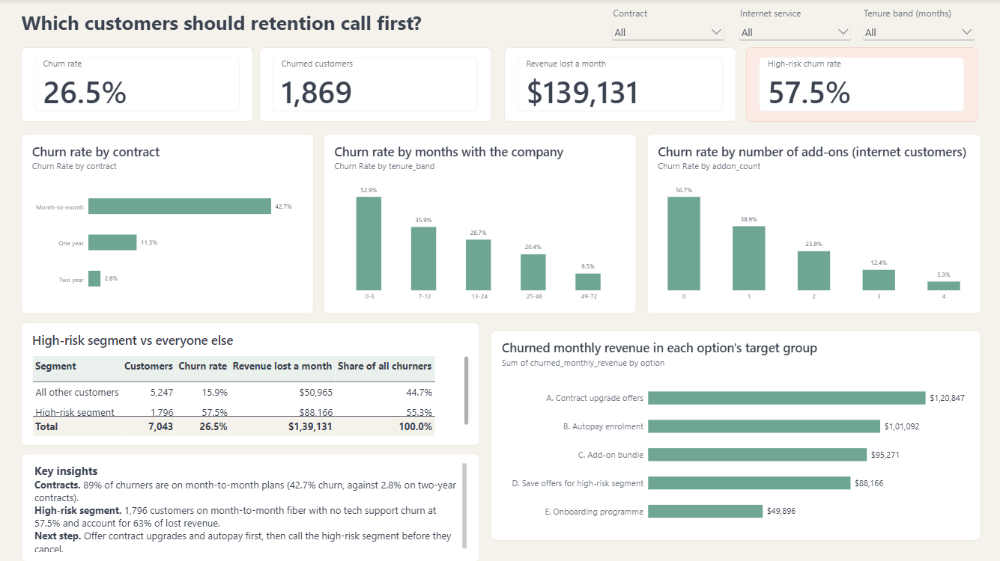

# Telecom Customer Churn: Which customers should retention call first?

A business analysis of customer churn at a telecom company, from problem statement to a recommendation leadership can act on. The analysis uses SQL, and the findings are presented in a Power BI dashboard and a short leadership deck.



## The business problem

About 1 in 4 customers leaves, and the company is losing roughly **$139,000 in monthly revenue** to churn. Retention has limited time and budget, so the question is where to point it first.

**Goal:** find who churns and why, size the revenue at stake, and recommend a retention plan with a realistic target.

## Data

IBM Telco Customer Churn sample dataset: 7,043 customers and 21 columns (contract, tenure, services, billing, monthly charges, churn flag).
I added a few derived fields: tenure band, autopay flag, add-on count and a high-risk flag.

## Key findings

| Finding | Number |
|---|---|
| Overall churn rate | 26.5% (1,869 of 7,043 customers) |
| Monthly revenue lost to churn | $139,131 |
| Churn on month-to-month contracts | 42.7% (one-year 11.3%, two-year 2.8%) |
| Share of churners on month-to-month | about 89% |
| Churn in the first 6 months | 52.9%, falling to 9.5% after 4 years |
| Churn with no add-on services (internet customers) | 56.7%, falling to 5.3% with four add-ons |
| High-risk segment | 1,796 customers, 57.5% churn |

**High-risk segment:** month-to-month, fiber optic customers with no tech support. They are 1,796 customers (about a quarter of the base), churn at 57.5%, and account for 55% of churners and 63% of the monthly revenue lost.

## Recommendation

1. **Phase 1 (months 1-3):** capture exit reasons, start a weekly churn report, offer contract upgrades and autopay enrolment, and add a light welcome call.
2. **Phase 2 (months 4-6):** build the high-risk list and make save offers; pilot an add-on bundle.
3. **Phase 3 (months 7-12):** full onboarding programme, review progress against the churn target, decide on the bundle rollout.

### Business case (assumptions, not company data)

- Costs are placeholders I set per customer targeted plus a one-time setup cost. Finance would replace them with real figures. The full plan is assumed to cost about $217K.
- Every option breaks even below roughly a 7% save rate.
- At a 10% save rate, churn falls from 26.5% to about 24.0%.
- Reaching a 20% churn target would need a save rate of about 25%, worth roughly $411,000 a year. So 20% is a stretch goal, not a safe first-year target.

## What is in this repo

```
data/
  WA_Fn-UseC_-Telco-Customer-Churn.csv   original dataset
  telco_prepared.csv                     dataset with derived fields
  retention_options.csv                  five retention options and the churned revenue in each target group
sql/
  telco_churn_analysis.sql               table, view and analysis queries (SQLite)
dashboard/
  churn_dashboard.pbix                   Power BI dashboard
  dashboard_preview.png                  screenshot
docs/
  Business_Analysis_Report.pdf           problem statement, stakeholders, root cause, requirements, cost-benefit, KPIs
  Leadership_Deck.pdf                    8-slide summary for leadership
```

## Business analysis covered

Problem statement, stakeholder map, AS-IS and TO-BE customer journeys, root cause analysis (fishbone and 5 Whys), requirements and user stories, impact-versus-effort prioritisation, cost-benefit with break-even save rates, KPI framework, assumptions and limitations.

## How to reproduce

**SQL**
1. Import `WA_Fn-UseC_-Telco-Customer-Churn.csv` into SQLite (for example with DB Browser for SQLite) as a table named `telco_customers`.
2. Run `sql/telco_churn_analysis.sql`. It creates the `v_customers` view with the derived fields and then runs the queries.

**Dashboard**
1. Open `dashboard/churn_dashboard.pbix` in Power BI Desktop.
2. To apply the theme to a new report, use View > Themes > Browse for themes and choose `Churn_Pastel_theme.json`.

Main DAX measures: Customers, Churned Customers, Churn Rate, Monthly Revenue, Churned Monthly Revenue, High-Risk Customers, High-Risk Churn Rate and Share of All Churners.

## Limitations

- This is a sample dataset with no dates, so trends over time cannot be analysed.
- Churn reasons are not in the data. The root causes are hypotheses to confirm with exit surveys, which is why exit-reason capture is the first step in Phase 1.
- Costs and save rates are assumptions for illustration.
- The analysis shows association, not proof of cause.

## Tools

SQL (SQLite), Power BI (DAX), Python (pandas) for verification.

## Author and Contact

Author: Spoorti Biradar |
Email: spoortibiradar8@gmail.com |
GitHub: https://github.com/spoortibiradar8

